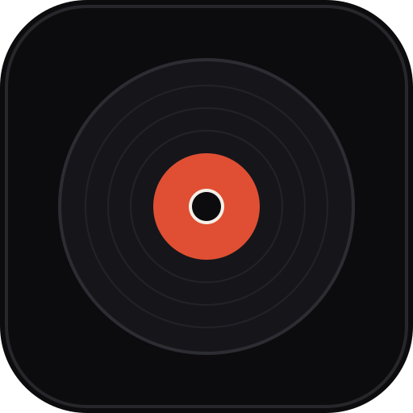

<div align="center">
  
  <h1>InterMusic</h1>
  <p>Lecteur de musique desktop sous Electron : catalogue Deezer, lecture YouTube et Discord Rich Presence.</p>
  <p>
    
    
    
  </p>
</div>

---

InterMusic réunit un catalogue musical (top albums, artistes, morceaux, genres), un lecteur
audio/vidéo YouTube sans publicité, des paroles synchronisées, un égaliseur 5 bandes, des
playlists locales avec import, un mini-lecteur flottant et Discord Rich Presence.

## Stack

- **Interface** : Vite 5, React 18, CSS custom (`src/index.css`)
- **Bureau** : Electron 41 (Linux AppImage, Windows NSIS & portable)
- **Métadonnées & lecture** : API Deezer, résolution YouTube avec bloqueur de publicités (`electron/ublock`)
- **Intégrations** : Discord Rich Presence (`electron/discord.cjs`), mises à jour automatiques (`electron-updater`)

## Démarrer

Prérequis : Node.js 20 ou plus récent.

```bash
npm install
npm run dev      # serveur Vite seul
npm run app      # build Vite + fenêtre Electron
```

### Packaging (Linux & Windows)

```bash
npm run dist
```

Génère les binaires dans `release/` (`InterMusic-<version>.AppImage`, `InterMusic Setup <version>.exe` et `InterMusic <version>.exe`).

## Structure

```
electron/
  main.cjs       Processus principal : fenêtre, mini-lecteur, IPC Deezer/YouTube, auto-updater
  preload.cjs    Pont IPC exposé au renderer (window.api)
  discord.cjs    Client Discord Rich Presence
  ublock/        Filtre anti-publicité chargé dans la session Electron
src/
  api.js         Appels Deezer, paroles et YouTube via window.api
  App.jsx        Navigation, lecteur principal et vues
  components/    Modales, lecteur, égaliseur, paroles, mini-lecteur, listes
  useList.js     Gestion locale des favoris et playlists
  useSettings.js Préférences utilisateur et égaliseur
  useYouTube.js  Contrôle de la lecture YouTube
build/           Icônes de l'application (Linux / Windows)
.github/         Workflow GitHub Actions pour publier les releases
```

## Mises à jour automatiques

L'application vérifie et télécharge les nouvelles versions via GitHub Releases (`electron-updater`).
Pour publier une mise à jour :

```bash
# 1. Incrémenter "version" dans package.json
git add package.json
git commit -m "chore: release v1.0.1"
git tag v1.0.1
git push origin main --tags
```

Le workflow `.github/workflows/release.yml` compile automatiquement l'AppImage Linux et les
installeurs Windows et publie la release.
